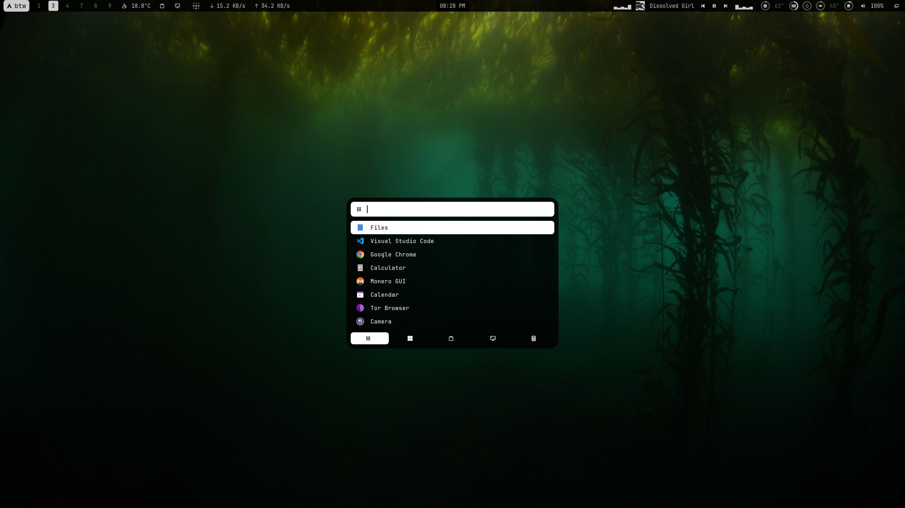
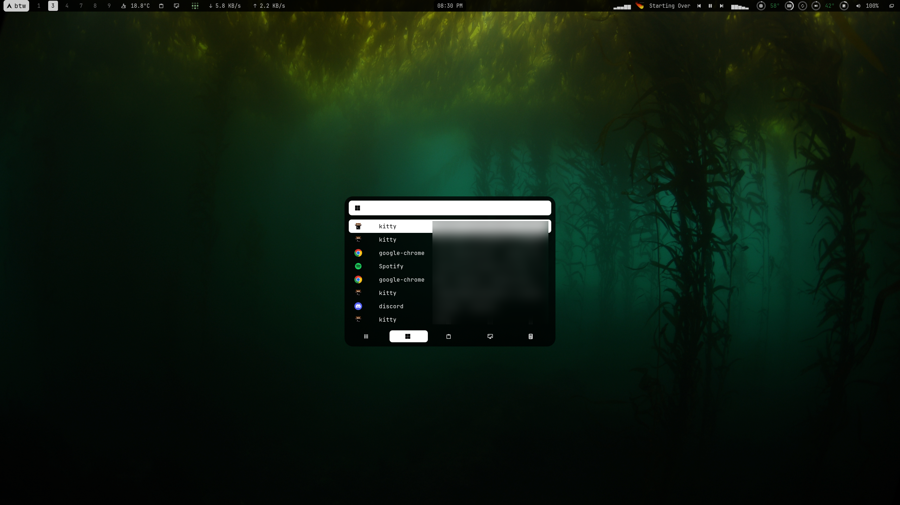
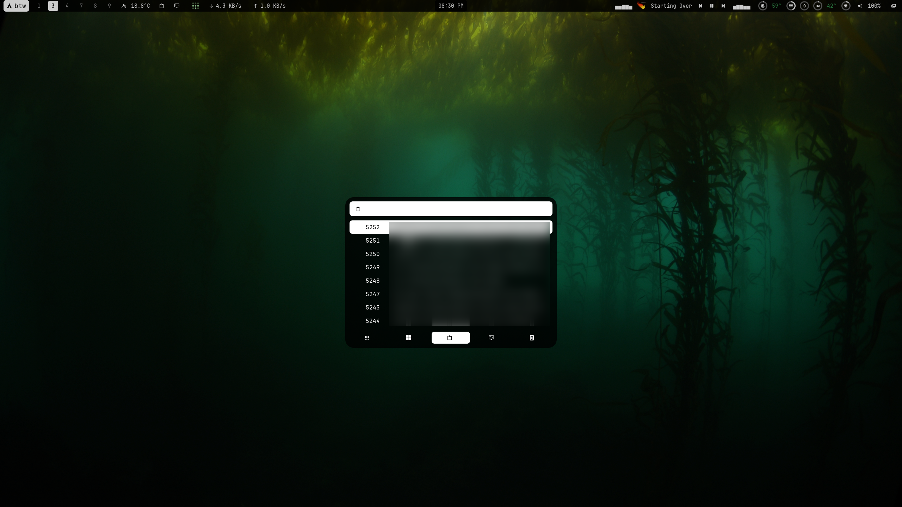
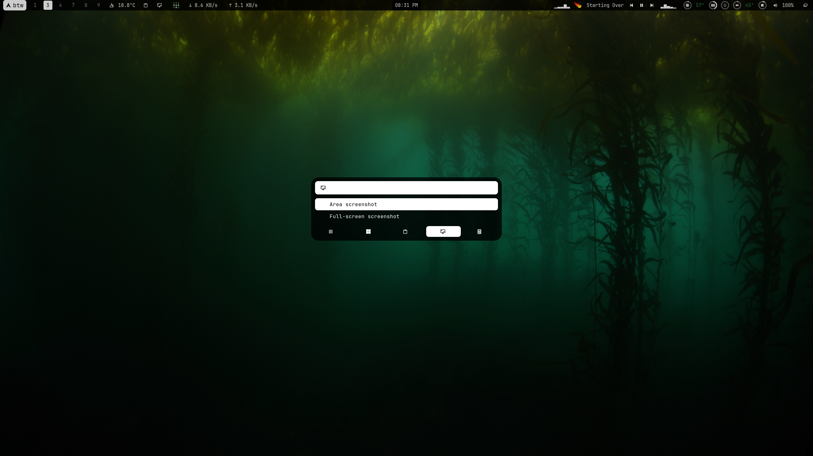
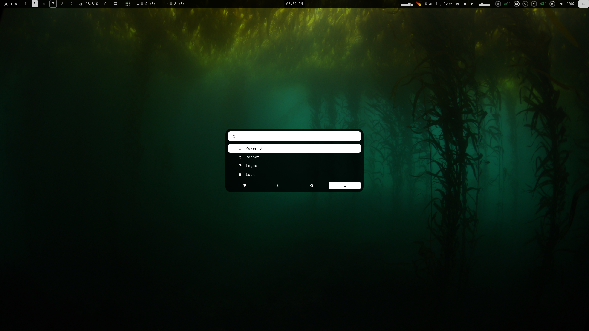
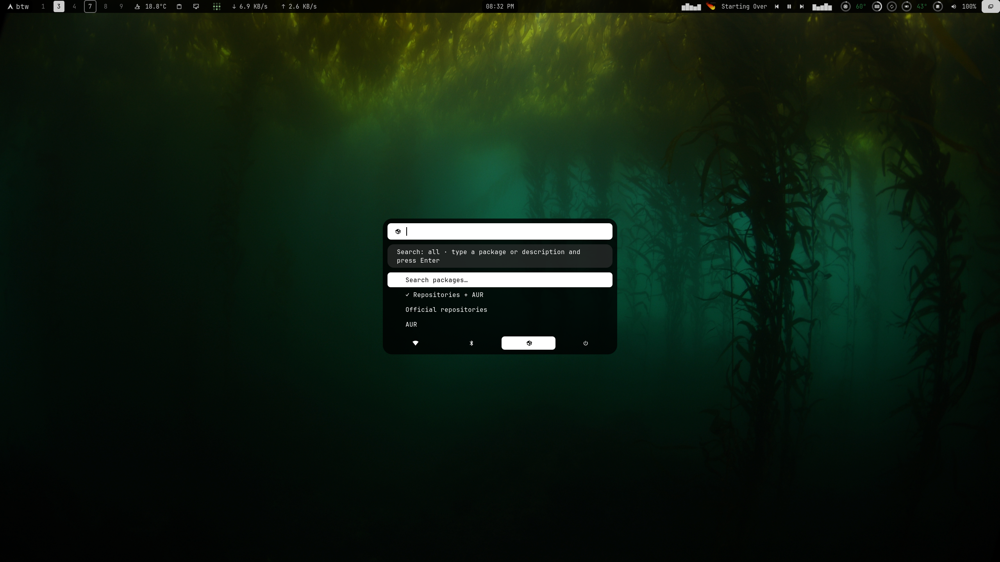
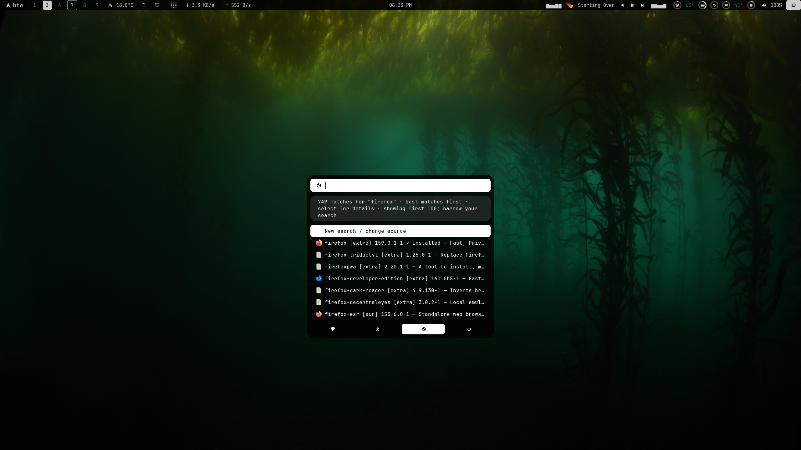
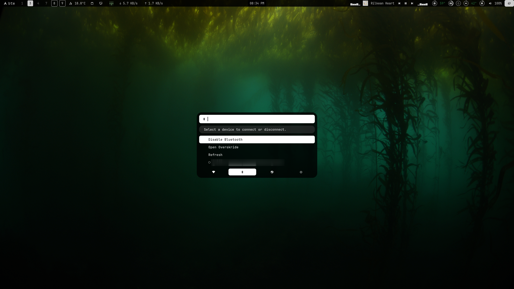
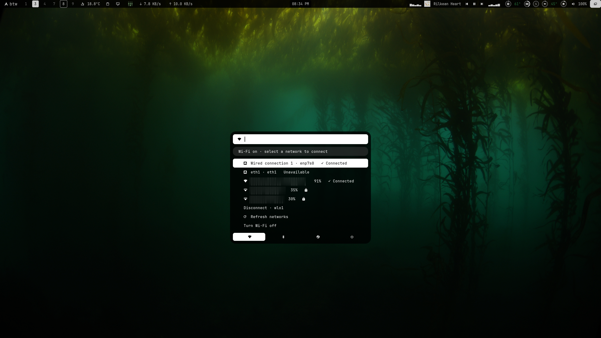

# Kelpos Rofi Theme

A rounded Rofi setup for Arch Linux and Hyprland: a recent-app launcher, window switcher, clipboard image previews, screenshots and calculator, plus Wi-Fi, Bluetooth, package and power controls.

Extracted from [Kelpos Waybar Theme](https://github.com/Otamarau/kelpos-waybar-theme). The menus can run independently of Waybar.

## Installation

Back up `~/.config/rofi` and any matching `~/.local/bin` helpers first. From this repository:

```sh
mkdir -p ~/.config/rofi/scripts ~/.local/bin
cp -a rofi/. ~/.config/rofi/
cp -a scripts/. ~/.config/rofi/scripts/
install -m 755 bin/* ~/.local/bin/
bash ~/.config/rofi/scripts/install-window-icons.sh
```

This copies the configuration; later repo updates must be copied again. Personal launch history, clipboard contents and caches are excluded.

For Hyprland configurations using traditional binding syntax:

```ini
bind = SUPER, SPACE, exec, ~/.local/bin/rofi-toggle.sh
bind = SUPER, R, exec, ~/.local/bin/rofi-recent
```

For the Lua configuration, bind the same commands using `hl.bind` and `hl.dsp.exec_cmd`. Point Waybar's Quick Menu click action at `~/.config/rofi/scripts/quick-controls-rofi.sh`.

## Dependencies

| Feature | Requirements |
| --- | --- |
| Launcher and theme | Rofi 2.0 with Wayland support, JetBrainsMono / JetBrainsMono Nerd Font, Adwaita icons, Python 3, PyGObject and GIO |
| Wi-Fi / Ethernet | NetworkManager, nmcli, libnm introspection, notify-send; networkmanager_dmenu and nm-connection-editor for advanced setup |
| Bluetooth | bluetoothctl, Overskride for discovery/pairing |
| Packages | pacman, yay for AUR/combined searches, sudo, Kitty, notify-send |
| Clipboard previews | cliphist, wl-clipboard, ImageMagick; your session must collect clipboard history |
| Screenshots | grim, slurp, wl-copy, notify-send |
| Calculator | Rofi calc plugin |
| Power | systemctl, hyprctl with the configured Lua exit dispatcher, hyprlock |

## Rofi launcher and Quick Menu

The included Rofi setup has two entry points: the app launcher for everyday desktop tasks and the Quick Menu for system controls. Both use the shared theme and icon tabs; switch tabs with **Left / Right** or click their icons.

### App launcher

Open `~/.local/bin/rofi-recent`, or use **Super + Space** after installing the bindings above. The toggle shortcut closes an already-open Rofi menu; clicking outside also dismisses it.

| Tab | Features |
| --- | --- |
| Applications | Application icons, recently launched apps first with an empty search, and fuzzy app-name search ranked by match quality. Launch history is tracked by the included wrapper. |
| Windows | Find and switch to an open window, with application icons. |
| Clipboard | Search saved text and image entries from cliphist. Images have cached thumbnail previews; selecting an entry copies the original text or full image back to the clipboard. |
| Screenshots | Capture a selected area or the full desktop, save a timestamped PNG under `~/Pictures/Screenshots`, copy it to the clipboard and show a notification. |
| Calculator | Evaluate expressions with the Rofi calc plugin and copy the accepted result to the clipboard. |

The companion Waybar configuration also provides direct clipboard and screenshot buttons. Left-click the screenshot button for an area capture; right-click for a full-desktop capture.

### Quick Menu

Open the Quick Menu from Waybar or run:

```sh
~/.config/rofi/scripts/quick-controls-rofi.sh
```

It starts on the **Power** tab, with **Network**, **Bluetooth** and **Packages** available alongside it.

### Wi-Fi picker and Ethernet

- Browse nearby Wi-Fi networks with signal percentages, signal-strength icons, open/secured indicators and a connected marker. The current network comes first, followed by other networks sorted by signal strength.
- Select a network to connect. Saved profiles are reused; new personal Wi-Fi connections open a masked password prompt.
- Refresh the network list, turn the Wi-Fi radio on or off, or disconnect an active wireless connection.
- View Ethernet interfaces, profile names and connection status; select a wired entry to open Connection Editor.
- Open the full network menu for hidden networks and advanced setup, or launch Connection Editor directly.

Passwords are passed to libnm in memory, rather than shell arguments or script-created password files. NetworkManager manages saved profiles. Enterprise authentication and other advanced connection setup use the external network tools. Wireless discovery requires a Wi-Fi adapter recognized by NetworkManager; the menu also reports unavailable adapters and hardware radio blocks.

### Package browser

The **Packages** tab searches **official repositories**, the **AUR**, or **both**. Choose a source, type at least two characters of a package name or description, and press **Enter**.

- Results show the package name, repository, version, description, application icon when available, and a checkmark for installed packages.
- Exact names rank first, with application matches ahead of language packs and add-ons. Results are limited to the first 100 matches; narrow the query for more specific results.
- Select a package to inspect details such as its description, version, URL, dependencies, download/installed sizes and AUR votes when supplied by the package source.
- Choose **Install in terminal** to open Kitty with an interactive installation: `sudo pacman` for repository packages or `yay` for AUR packages. Normal authentication and package-manager prompts remain visible.
- Return to results, start a new search or change source from within the menu. Loading notifications provide feedback during searches and detail retrieval.

Package icons use local icons where available, with cached Papirus downloads for missing matches. The older standalone `~/.config/rofi/scripts/pkgmanager.sh` offers **Install / Remove / Info** through yay; removal is available there, not in the Quick Menu package browser.

### Bluetooth

Enable or disable Bluetooth, refresh the known-device list, and select a device to connect or disconnect. Filled and empty circles indicate connection state. **Open Overskride** launches the full Bluetooth manager for discovery, pairing and PIN/confirmation workflows. The inline menu reports connection failures and unavailable adapters or services.

### Power

**Power Off**, **Reboot**, **Logout** and **Lock** are available in the Power tab. Logout uses the Hyprland Lua exit dispatcher, and Lock launches Hyprlock directly. Power actions execute when selected, without a separate confirmation menu.

## Screenshots

Captured from the running desktop. Clipboard contents, window titles, Wi-Fi network names and Bluetooth device details are blurred for privacy.

| Applications | Window switcher |
| --- | --- |
|  |  |

| Clipboard | Screenshot tools |
| --- | --- |
|  |  |

| Calculator | Power |
| --- | --- |
|  |  |

| Package sources | Package results |
| --- | --- |
|  |  |

| Bluetooth | Wi-Fi and Ethernet |
| --- | --- |
|  |  |

Capture more pages with `scripts/capture-rofi.py`; see [capture instructions](screenshots/README.md).

## Checks

```sh
python3 -m unittest discover -s tests -v
for script in scripts/*.sh rofi/scripts/*.sh bin/*.sh bin/rofi-clipboard; do bash -n "$script"; done
```

Menu tests simulate external services; they do not change network connections, radios or packages.

## Credits

The theme files retain their original author comments, including Newman Sanchez's rounded Rofi theme attribution. Package icon attribution and license information are retained under `scripts/package-icons/`. Fonts and system icon themes are installed separately.
